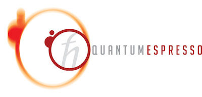

## This branch: noncollinear/SOC DFPT+U and Perturbo

Branch `soc-u-port` is Quantum ESPRESSO 7.6 with

- **ph.x**: DFPT+U for noncollinear magnetic ground states, with or without
  spin-orbit coupling, ported from qe-pert (QE 7.3);
- **perturbo/**: Perturbo with the qe-pert SOC+U `qe2pert.x`, ported to QE 7.6.

`main` is the unmodified QE 7.6. Validation runs and known issues:
[docs/soc_u_port/PORT_STATUS.md](docs/soc_u_port/PORT_STATUS.md).

### Build

```bash
./configure --with-hdf5=/path/to/hdf5 [options]   # HDF5: needed by Perturbo
make pw ph pp                    # pp: pw2wannier90.x
cd perturbo && make              # qe2pert.x, perturbo.x -> perturbo/bin
```

`perturbo/make.sys` uses the Intel flag `-qopenmp`; use `-fopenmp` with GNU
compilers. Wannier90 is external.

### New ph.x input variables (`&inputph`)

| Variable | Default | Meaning |
| --- | --- | --- |
| `lhubbard_soc` | `.false.` | Enables DFPT+U for a noncollinear DFT+U ground state. Without it ph.x stops for such a ground state. |
| `hubbard_conv` | `'potential'` | Convergence test of the Hubbard occupation response dN, required together with the Hxc test (`tr2_ph`). `'potential'`: max_I U_I \|dN_out - dN_in\| (Ry). `'relative'`: max \|dN_out - dN_in\| / max \|dN\| (the QE 7.3 test; may be unreachable when dN vanishes by symmetry). `'none'`: Hxc test only (diagnostic). |
| `hubbard_conv_thr` | `sqrt(tr2_ph)` | Threshold of the Hubbard test. The Hubbard residual has a numerical floor of about 1e-8 Ry (NiO tests), so a tight `tr2_ph` (e.g. `1d-18`) needs a separate value such as `1d-7`. A value <= 0 selects the default. |
| `hubbard_mix` | `'joint'` | `'joint'`: U*dN and the Hxc potential response in one Broyden vector (`nmix_ph`). `'linear'`: Broyden on Hxc only, linear mixing of dN (slower in the tests; kept as an option). |
| `alpha_mix_hub` | `alpha_mix` (`'joint'`), 1 (`'linear'`) | Mixing step of the Hubbard block, 0 < `alpha_mix_hub` <= 2. A value <= 0 selects the default. |

All but `lhubbard_soc` are used only with `lhubbard_soc=.true.`. Full
descriptions are in [PHonon/Doc/INPUT_PH.def](PHonon/Doc/INPUT_PH.def).

In the NiO tests, `alpha_mix(1)=0.7`, `nmix_ph=12`, `alpha_mix_hub=1.0`
roughly halved the work of a tight `tr2_ph` run at Gamma and finite q,
with phonon frequencies unchanged within convergence noise (finite q:
dynamical matrix relative difference ~1e-6). The defaults are unchanged.

```fortran
&inputph
  prefix = 'NiO', outdir = './out'
  tr2_ph = 1.0d-18
  lhubbard_soc = .true.
  hubbard_conv_thr = 1.0d-7
  alpha_mix(1) = 0.7, nmix_ph = 12, alpha_mix_hub = 1.0
  ldisp = .true., nq1 = 2, nq2 = 2, nq3 = 2
  fildyn = 'NiO.dyn.xml'          ! XML dynamical matrices: read by qe2pert
  fildvscf = 'dvscf'              ! dvscf: read by qe2pert
/
```

Scope with `lhubbard_soc=.true.` (ph.x stops otherwise):

- magnetic noncollinear ground state, with or without SOC; fixed U_eff
  (dU/du = 0), Dudarev `lda_plus_u_kind=0`, `HUBBARD {atomic}`, one Hubbard
  manifold per atom, no orbital-resolved U;
- norm-conserving pseudopotentials only (no USPP/PAW);
- insulators: fixed occupations (no smearing or tetrahedra);
- phonons at Gamma and finite q (`ldisp` without `lshift_q`) and static
  `epsil`/`zeu`; not `elph`, Raman, `elop`, `fpol`, `only_wfc`,
  `read_dns_bare`.

### Perturbo (qe2pert)

ph.x writes the Hubbard responses read by qe2pert (`dnsscf`,
`dnsbare_pattern`) without extra input. After the ph.x run, collect the
responses into qe2pert's flat `phdir`:

```bash
python3 dev-tools/collect_qe2pert_ph.py --source out --dyn0 NiO.dyn0 \
    --prefix NiO --output phdir --mode hardlink    # --hubbard none without U
```

Run `qe2pert.x` with as many pools as MPI ranks (`mpirun -np N qe2pert.x -nk N`).
Details: [dev-tools/README.md](dev-tools/README.md).

qe2pert was checked against the qe-pert (QE 7.3) qe2pert on the same 7.6
ph.x data: relative e-ph differences 2.9e-7 (NiO, SOC+U), 4.9e-6 (GaAs,
SOC) and 1.1e-7 (graphene, 2D cutoff); all other qe2pert output identical. Not tested
here: collinear +U and USPP e-ph, `perturbo.x` runs. PAW is not supported by
qe2pert. The Perturbo regression data (`perturbo/tests/inputs`, `tests/refs`)
are not included; copy them from upstream Perturbo to run its test suite.

---

This is the distribution of the Quantum ESPRESSO suite of codes (ESPRESSO:
opEn-Source Package for Research in Electronic Structure, Simulation, and
Optimization)

[](https://www.gnu.org/licenses/old-licenses/gpl-2.0.en.html)

## USAGE
Quick installation instructions for CPU-based machines. For GPU execution, see
file [README_GPU.md](README_GPU.md). Go to the directory where this file is. 

Using "make"
(`[]` means "optional"):
```
./configure [options]
make all
```
"make" alone prints a list of acceptable targets. Optionally,
`make -jN` runs parallel compilation on `N` processors.
Link to binaries are found in bin/.

Using "CMake" (v.3.14 or later):

```
mkdir ./build
cd ./build
cmake -DCMAKE_Fortran_COMPILER=mpif90 -DCMAKE_C_COMPILER=mpicc [-DCMAKE_INSTALL_PREFIX=/path/to/install] ..
make [-jN]
[make install]
```
Although CMake has the capability to guess compilers, it is strongly recommended to specify
the intended compilers or MPI compiler wrappers as `CMAKE_Fortran_COMPILER` and `CMAKE_C_COMPILER`.
"make" builds all targets. Link to binaries are found in build/bin.
If `make install` is invoked, directory `CMAKE_INSTALL_PREFIX`
is prepended onto all install directories.

For more information, see the general documentation in directory Doc/, 
package-specific documentation in \*/Doc/, and the web site 
http://www.quantum-espresso.org/. Technical documentation for users and
developers 
can be found on [Wiki page on gitlab](https://gitlab.com/QEF/q-e/-/wikis/home).

## PACKAGES

- PWscf: structural optimisation and molecular dynamics on the electronic ground state, with self-consistent solution of DFT equations;
- CP: Car-Parrinello molecular dynamics;
- PHonon: vibrational and dielectric properties from DFPT (Density-Functional Perturbation Theory);
- TD-DFPT: spectra from Time-dependent DFPT;
- HP: calculation of Hubbard parameters from DFPT;
- EPW: calculation of electron-phonon coefficients, carrier transport, phonon-limited superconductivity and phonon-assisted optical processes;
- PWCOND: ballistic transport;
- XSpectra: calculation of X-ray absorption spectra;
- PWneb: reaction pathways and transition states with the Nudged Elastic Band method;
- GWL: many-body perturbation theory in the GW approach using ultra-localised Wannier functions and Lanczos chains;
- QEHeat: energy current in insulators for thermal transport calculations in DFT.
- KCW: Koopmans-compliant functionals in a Wannier representation

## Modular libraries
The following libraries have been isolated and partially encapsulated in view of their release for usage in other codes as well:

- UtilXlib: performing basic MPI handling, error handling, timing handling.
- FFTXlib: parallel (MPI and OpenMP) distributed three-dimensional FFTs, performing also load-balanced distribution of data (plane waves, G-vectors and real-space grids) across processors.
- LAXlib: parallel distributed dense-matrix diagonalization, using ELPA, SCALapack, or a custom algorithm.
- KS Solvers: parallel iterative diagonalization for the Kohn-Sham Hamiltonian (represented as an operator),using block Davidson and band-by-band or block Conjugate-Gradient algorithms.
- LRlib: performs a variety of tasks connected with (time-dependent) DFPT, to be used also in connection with Many-Body Perturbation Theory.
- upflib: pseudopotential-related code.
- devXlib: low-level utilities for GPU execution

## Contributing
Quantum ESPRESSO is an open project: contributions are welcome.
Read the [Contribution Guidelines](CONTRIBUTING.md) to see how you
can contribute.

## LICENSE

All the material included in this distribution is free software;
you can redistribute it and/or modify it under the terms of the GNU
General Public License as published by the Free Software Foundation;
either version 2 of the License, or (at your option) any later version.

These programs are distributed in the hope that they will be useful, but
WITHOUT ANY WARRANTY; without even the implied warranty of MERCHANTABILITY
or FITNESS FOR A PARTICULAR PURPOSE. See the GNU General Public License
for more details.

You should have received a copy of the GNU General Public License along
with this program; if not, write to the Free Software Foundation, Inc.,
675 Mass Ave, Cambridge, MA 02139, USA.
